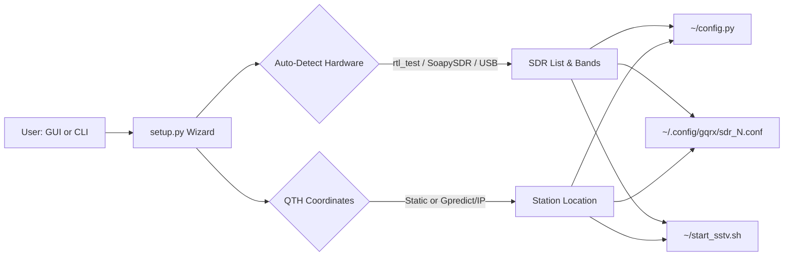
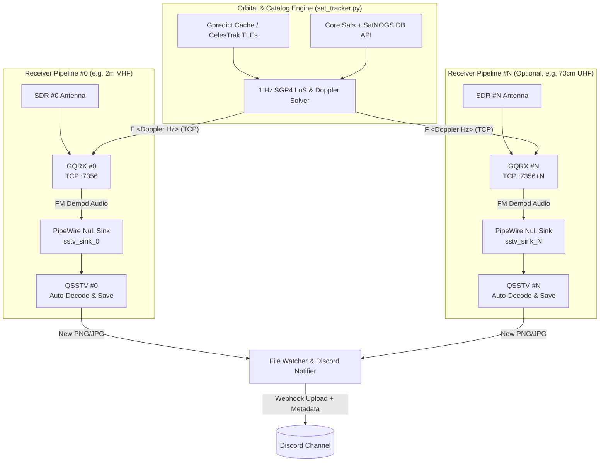
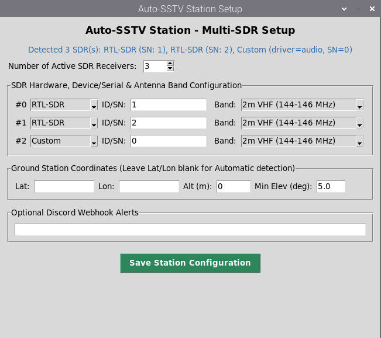
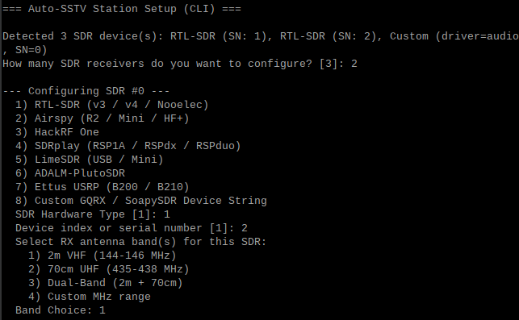

# Auto-SSTV Station — 24/7 Multi-SDR & Multi-Band Satellite RX

**Auto-SSTV Station** is a hands-free, 24/7 automated satellite Slow-Scan Television (SSTV) receiving system designed for Raspberry Pi OS and Linux desktops (Wayland, X11, and VNC).

## Project Goal & Purpose

Capturing SSTV images from amateur radio satellites (such as the **ISS**, **SONATE-2**, and **UMKA-1**) typically requires sitting at a computer during narrow orbital passes, manually clicking tracking windows, correcting Doppler shift, and routing audio cables. On modern **Raspberry Pi OS Bookworm (Wayland)**, traditional GUI-clicking scripts (`xdotool`) fail, PipeWire resets audio sinks when headless, and GQRX stalls on crash dialogs after power outages.

**Auto-SSTV Station** solves these problems by replacing fragile GUI automation with direct TCP Rigctl control, PipeWire virtual audio routing, and live orbital mechanics—allowing your station to run unattended 24/7 and automatically decode and forward images whenever a satellite transmits overhead.

## System Architecture & Pipeline Flow

### 1. Initialization Phase (`setup.py`)


### 2. 24/7 Automated Runtime & Multi-SDR Pipeline


## Setup Wizard Screenshots (GUI & CLI)

| Graphical Setup Wizard (`python3 setup.py`) | Terminal CLI Wizard (`python3 setup.py --cli`) |
| :---: | :---: |
|  |  |

## Key Features

- **Interactive Setup Wizard (`setup.py`):** Launches a Tkinter GUI on desktop/VNC or falls back automatically to an interactive terminal CLI (`--cli`) over SSH.
- **Multi-SDR & Multi-Band Support:** Run one dual-band SDR or multiple dedicated SDRs simultaneously (each isolated with its own GQRX config, TCP port `7356+`, PipeWire audio sink, and QSSTV save directory).
- **Hybrid Satellite & Coordinate Discovery:** Automatically detects your QTH via Gpredict `.qth` or IP geolocation (or uses your static coordinates) and merges active 2m/70cm SSTV transmitters from **SatNOGS DB** onto a guaranteed core baseline (**ISS**, **SONATE-2**, **UMKA-1**).
- **Real-Time Doppler Correction:** Tunes GQRX every second via TCP Rigctl (`F <Hz>`) whenever a target rises above your minimum horizon elevation (`5.0°` default).
- **Power-Outage Resilience:** `start_sstv.sh` clears GQRX crash flags (`crashed=false`), rebuilds virtual audio cables, and starts the DSP waterfall (`U DSP 1`) automatically on boot.
- **Optional Discord Image Alerts:** Monitors QSSTV output folders and uploads newly decoded frames to a Discord webhook with satellite name, elevation, and frequency metadata.

## Supported SDR Hardware

| SDR Family | GQRX Device Format | Auto-Detection |
| :--- | :--- | :--- |
| **RTL-SDR** (v3 / v4 / Nooelec) | `rtl=<serial_or_index>` | `rtl_test` + USB |
| **Airspy** (R2 / Mini / HF+) | `airspy=<index>` | `SoapySDRUtil` + USB |
| **HackRF One** | `hackrf=<index>` | `SoapySDRUtil` + USB |
| **SDRplay** (RSP1A / RSPdx / RSPduo) | `soapy=<index>,driver=sdrplay` | `SoapySDRUtil` + USB |
| **LimeSDR** (USB / Mini) | `soapy=<index>,driver=lime` | `SoapySDRUtil` + USB |
| **ADALM-PlutoSDR** | `soapy=<index>,driver=plutosdr` | `SoapySDRUtil` + USB |
| **Ettus USRP** (B200 / B210) | `uhd` | USB |
| **Custom SoapySDR** | Any custom GQRX string | Manual entry |

## Installation & Quick Start

### 1. Install System Dependencies
```bash
sudo apt update
sudo apt install -y gqrx-sdr qsstv gpredict rtl-sdr python3-ephem python3-tk pipewire-audio-client-libraries pulseaudio-utils curl git
```

### 2. Clone the Repository
```bash
git clone https://github.com/Stavros/auto-sstv-station.git
cd auto-sstv-station
cp sat_tracker.py setup.py ~/
```

### 3. Run the Setup Wizard (GUI or CLI)
- **Graphical Wizard (VNC / Desktop):**
  ```bash
  python3 ~/setup.py
  ```
- **Terminal Wizard (SSH / Headless):**
  ```bash
  python3 ~/setup.py --cli
  ```

The wizard generates three local files:
1. `~/config.py` — Your private station coordinates, SDR hardware list, and optional Discord webhook (ignored by Git).
2. `~/.config/gqrx/sdr_*.conf` — Isolated GQRX profiles with Rigctl TCP enabled.
3. `~/start_sstv.sh` — Boot startup script for PipeWire virtual cables, GQRX, QSSTV, Gpredict, and `sat_tracker.py`.

### 4. Configure QSSTV & Autostart
1. Launch `~/start_sstv.sh` once and configure **QSSTV** (`Options -> Configuration`):
   - **Sound:** Set Audio Interface to **PulseAudio**.
   - **Directories / Autosave:** Enable **Autosave** on the **Receive** tab so decoded images save automatically to `~/qsstv/rx_sstv`.
2. Add a nightly TLE update cron job (`crontab -e`):
   ```cron
   0 3 * * * gpredict --update-tle >/dev/null 2>&1
   ```
3. Add `~/start_sstv.sh` to your desktop autostart (`~/.config/autostart/sstv.desktop`) for hands-free recovery after reboots.

## Project Structure

- `setup.py` — Interactive Tkinter GUI & CLI station configurator.
- `sat_tracker.py` — Multi-SDR SGP4 pass scheduler, Doppler controller, SatNOGS/CelesTrak fetcher, and Discord uploader.
- `config.example.py` — Reference template showing available local configuration variables.

## License & Credits

Built with AI assistance by **SV2HZK**. Released under the **MIT License**. 73!
